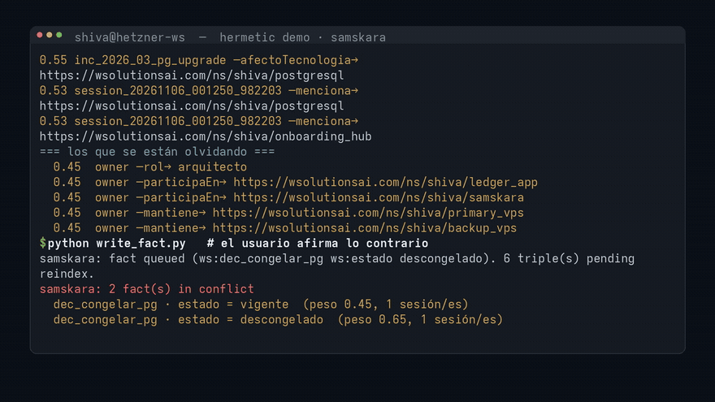
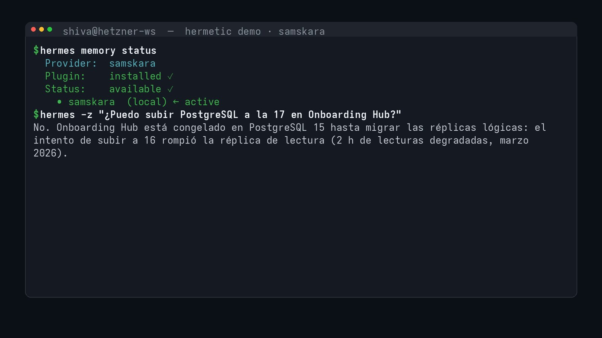
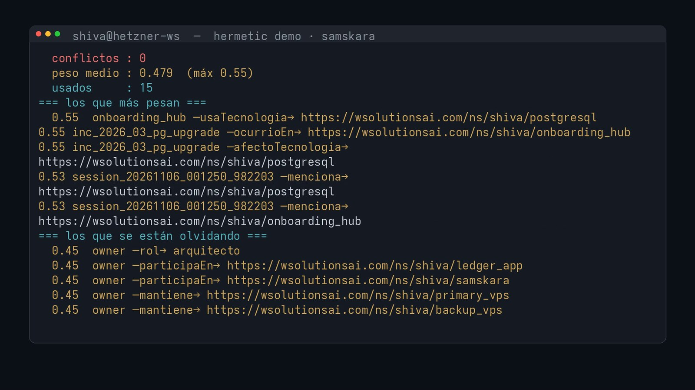
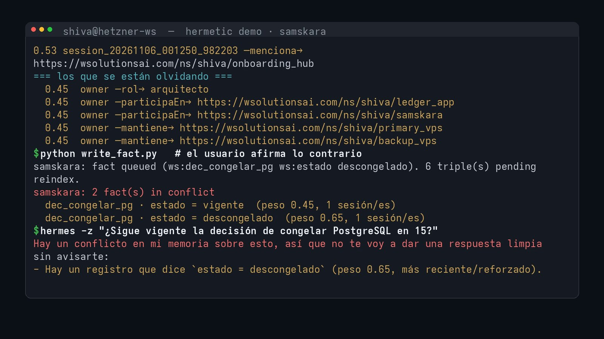
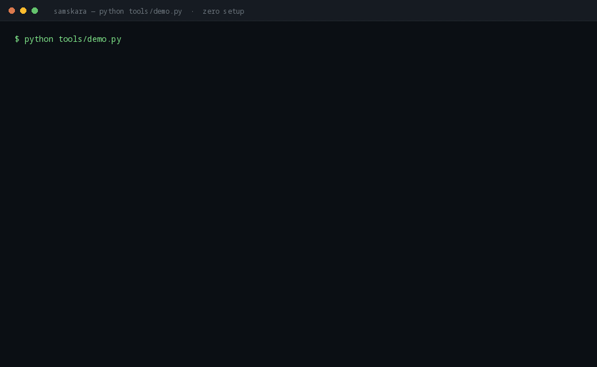

# Samskara — memory that admits doubt

**Relational memory for Hermes Agent.** Where a vector store answers *"what looks
similar?"*, Samskara answers *"what depends on this, and why"* — and when two
memories contradict each other, it says so instead of picking one.

[](https://github.com/SebaWag/hermes-samskara/actions/workflows/ci.yml)


> **Samskara** (Sanskrit: *saṃskāra*) — the latent impression an experience leaves
> behind, which shapes what happens next.

Most agent memory stores **text** and retrieves it by similarity. Samskara stores
**relations** and retrieves them by **path**. That is the difference between:

> *"Here are five paragraphs that look like your question"*

and

> *"You cannot upgrade PostgreSQL on Onboarding Hub — a decision from March is
> still in force, and here is the incident that caused it, in 16 ms."*

Every recall block Samskara injects into a turn carries its own **provenance**:
how many entities, how many facts, and how many milliseconds the graph took to
answer. Memory you cannot audit is memory you cannot trust.

---

## Demo

[](https://github.com/SebaWag/hermes-samskara/releases/download/v0.2.0/SAMSKARA_DEMO.mp4)

*The agent is asked whether a decision from months ago is still in force. It finds
two contradictory facts, weights them, and says so instead of picking one.*

**[▶ Watch the full 66-second demo with audio](https://github.com/SebaWag/hermes-samskara/releases/download/v0.2.0/SAMSKARA_DEMO.mp4)**

| Recall with provenance | Weights that decay | Conflicts surfaced |
|---|---|---|
|  |  |  |

---

## How fast it actually is

Measured, not estimated. Every number below came from `python tools/bench.py` on
**aarch64 · 4 vCPU · Python 3.10**, against the demo corpus on loopback:

| What | Measured |
|---|---|
| One SPARQL query, loopback (wall clock) | **0.87 ms** best · 0.95 ms median |
| The same query, engine execution only | **0.05 ms** |
| Full recall, graph only — question in, memory out (10 queries) | **10.2 ms** best · 11.0 ms median |
| Full recall, default path — graph + weights + conflicts + reinforcement | **16.0 ms** best · 16.4 ms median |
| `Journal.append()` — batch of 50, fsync | 23,600 triples/s |
| `FactStore.record()` — SQLite sidecar | 47,700 triples/s |
| `recall.render()` — 5 entities × 24 facts | 0.70 ms |

```bash
python tools/bench.py                                         # offline rows only
python tools/bench.py --endpoint http://127.0.0.1:1235/sparql # adds end-to-end recall
```

**Read the gap between the first two rows, because it is the honest finding:**
the engine plans and executes a query in **0.05 ms**, and the wall clock is
**0.87 ms**. A recall is 10 round trips, so it costs ~10 ms — and ~16 ms once the
weight sidecar and the conflict check run. Latency here is dominated by the
transport, not by the graph, which is why co-locating the graph matters: over an
SSH tunnel the same recall takes **~10 seconds**.

> **And a correction we owe you.** Until v0.2.1 the block header reported
> `client.last_ms` — the time of the **last** query — so a recall that took 10 ms
> announced itself as `0.87 ms`. The number was real, the label was not. It now
> reports the whole pipeline and how many queries it took:
> `[… · 18 hecho(s) · 10 consulta(s) · 10.17 ms]`. A plugin whose entire argument
> is *"memory that admits doubt"* cannot flatter its own latency.

---

## Why a graph instead of another vector store

| | Vector memory | Samskara |
|---|---|---|
| Unit of storage | chunk of text + embedding | entity + relation |
| Retrieval | nearest neighbours | traversal (1..n hops) |
| Answers "what is similar?" | ✅ | ✅ (via label match) |
| Answers "what depends on this, and why?" | ❌ | ✅ |
| Can it explain itself? | similarity score | the actual path + source facts |
| Works on a 3-hop question | degrades | one query |

Vector search cannot answer *"which projects use PostgreSQL **and** are covered
by a decision that is still in force"* — that is not a distance, it is a path.

### How it compares

Compared **only on what each plugin's catalog entry documents**. "Not documented"
means the entry does not say — not that the plugin cannot do it.

| Provider | Unit of memory | Retrieval | Per-fact weight | Surfaces contradictions | Needs a service |
|---|---|---|:--:|:--:|---|
| Vector memory (typical) | text chunk + embedding | nearest neighbours | — | — | usually |
| `agentmemory` | memory scoped to profile/project/author | automatic recall | not documented | not documented | AgentMemory server |
| `agent_memory_es` | episodic / semantic / procedural | hybrid BM25 + kNN | not documented | not documented | Elasticsearch service |
| `agentplaybooks-memory` | personal and team playbooks | bounded keyword recall | not documented | not documented | AgentPlaybooks service |
| **`samskara`** | **entity + relation** | **traversal, 1..n hops** | **yes** | **yes, by design** | **none — stdlib only** |

These are neighbours, not rivals: a vector store answers *"what looks like this?"*
and a graph answers *"what depends on this, and why?"*. Most agents want both.
Samskara is the graph half, and it is the only one of the four that ships with no
external service to run.

---

## Try it in one command, with nothing installed

```bash
git clone https://github.com/SebaWag/hermes-samskara
cd hermes-samskara && python tools/demo.py
```

No graph server. No Docker. No API key. No network. `tools/demo.py` parses the
**69-triple demo corpus in process** and runs the same `recall()` Hermes calls
before a turn — you get the weighted block, the reinforcement, and the conflict,
in about a second.



*Recorded from a real run. Lines skipped for length are marked with `⋮`.*

```
1) ¿puedo subir PostgreSQL a la 17 en Onboarding Hub?
[memoria relacional · samskara · 3 entidad(es) · 18 hecho(s) · 10 consulta(s) · 0.18 ms]
• PostgreSQL  (postgresql)
   ← usa tecnologia: Onboarding Hub  ·0.45
   ...
3) now teach the opposite and ask again
[conflicto · dos versiones del mismo hecho, no elijo por ti]
   dec_congelar_pg · estado = descongelado  (peso 0.53, 1 sesión/es)
   dec_congelar_pg · estado = vigente  (peso 0.45, 1 sesión/es)
```

That is the embedded backend: a read-only, in-process store behind the same
client interface. **Its scope is honest and narrow** — it answers the three query
shapes Samskara issues (label search, outgoing and incoming neighbourhood) and
**refuses anything else** rather than guessing, because a wrong answer from memory
is worse than no answer.

```bash
# zero-setup, in-process
export SAMSKARA_ENDPOINT=embedded://seed/demo.ttl

# or a real corpus, unchanged code
export SAMSKARA_ENDPOINT=http://127.0.0.1:1234/sparql
```

---

## Install

```bash
hermes plugins install SebaWag/hermes-samskara
hermes plugins enable samskara
hermes config set memory.provider samskara
```

Then point Samskara at your graph. It speaks plain SPARQL-over-HTTP, so any
endpoint that answers `POST /sparql` works (MillenniumDB, Oxigraph, Jena,
Blazegraph, Neptune, …). If you just want to see it work, skip the server
entirely with `SAMSKARA_ENDPOINT=embedded://seed/demo.ttl`:

```bash
# in $HERMES_HOME/.env
SAMSKARA_ENDPOINT=http://127.0.0.1:1234/sparql
```

If your endpoint sits behind basic auth, the password is a **credential**, so it
is resolved by the host, not by us: Samskara calls
`agent.secret_scope.get_secret("SAMSKARA_PASSWORD")` and never reads
`os.environ` itself. That is the path a multiplexing gateway uses, where a miss
fails closed instead of handing back another profile's value; in a
single-profile deployment the host may resolve it from the process environment,
by design (systemd, `op run`). `hermes memory setup` writes it for you; declared
by hand it lives in the same `.env`:

```bash
SAMSKARA_USERNAME=reader
SAMSKARA_PASSWORD=...      # read via agent.secret_scope.get_secret
```

It is never written to `samskara.json` and never logged.

Or persistently in `$HERMES_HOME/samskara.json` — the whole settings surface:

```json
{
  "endpoint": "http://127.0.0.1:1234/sparql",
  "auto_recall": true,
  "extract_on_session_end": true,
  "max_entities": 3,
  "max_facts": 24,
  "max_chars": 1200,
  "timeout": 8.0,
  "write_mode": "journal"
}
```

`hermes memory setup` deliberately asks for **three** things — `endpoint`,
`username`, `password` — and nothing else. The rest are tuning knobs with
defaults, so they live here instead of in a seven-question wizard.

Verify:

```bash
hermes memory status     # → Plugin: installed ✓ · Status: available ✓ · samskara ← active
```

### Running a graph next to the agent

MillenniumDB is a 49 MB container that holds this demo corpus in **18 MiB of RAM**:

```bash
docker run -d --name samskara-mdb --restart unless-stopped \
  -p 127.0.0.1:1234:1234 \
  -v /srv/samskara:/data \
  imfd/millenniumdb:latest bash -c "mdb server /data/db -p 1234 --browser false"
```

> **Co-locate the graph with the agent.** Measured on the demo corpus: **0.87 ms
> per query over loopback vs ~1000 ms over an SSH tunnel between datacentres**.
> A recall issues ~10 queries, so the tunnel turns a **16 ms** recall into a
> **10 second** turn. Memory belongs next to the agent — for latency *and* for
> sovereignty.

---

## What it actually does in a turn

```
user asks ──► prefetch()      find entities → expand both directions → inject block
              (Samskara)      [memoria relacional · 3 entidades · 18 hechos · 1.27 ms]
                     │
model answers ───────┘
                     │
              sync_turn()     buffer the turn (no I/O, no latency)
                     │
context full ─► on_pre_compress()  extract entities BEFORE compression, journal
                                    the relations → the graph keeps what the
                                    transcript is about to forget
```

### The part that matters: `on_pre_compress`

Compression is lossy for prose and, with Samskara, **lossless for relations**.
Before Hermes summarises the context away, Samskara resolves the entities the
session talked about and writes the edges to the journal — so a fact mentioned
in turn 3 is still retrievable in session 40.

---

## Tools exposed to the model

| Tool | Purpose |
|---|---|
| `samskara_search` | Resolve names in free text to real entities, with facts in both directions |
| `samskara_query` | Read-only SPARQL — follow relations across hops (SELECT/ASK only) |
| `samskara_write` | Persist one fact; appended to the journal, folded in on reindex |
| `samskara_status` | Health + telemetry (endpoint, entity count, latency, error count) |

---

## Write path: why a journal

The open-source MillenniumDB build is **import-only** — it rejects SPARQL
`INSERT`. Rather than hide that, Samskara turns it into a guarantee:

1. `samskara_write` and `on_pre_compress` append to
   `$HERMES_HOME/samskara/journal/session-*.ttl` (single write, `fsync`, done).
2. A reindex folds the journal into the graph: dump → concatenate → import →
   archive the applied journals.

A write therefore costs microseconds and **can never slow down or fail a turn**.
Print the exact commands for your layout:

```python
from samskara_core.journal import reindex_commands
print("\n".join(reindex_commands("/srv/samskara", "/root/.hermes/samskara/journal")))
```

---

## Ontology

Any RDF works: entity resolution only needs `rdfs:label` on the things you want
to find. The bundled demo corpus uses this prefix:

```
ws:  https://wsolutionsai.com/ns/shiva/
```

Change it in `samskara_core/client.py` (`PREFIXES`) or pass full IRIs.

---

## Demo corpus

`seed/demo.ttl` (72 lines) models a real dev team: projects, technologies, an
infrastructure, an incident, and the decision that is still in force. It exists
to demonstrate the one thing vector memory cannot do:

```sparql
SELECT ?proyecto ?decisionLabel WHERE {
  ?proyecto ws:usaTecnologia ws:postgresql ;
            rdfs:label ?proyectoLabel .
  ?decision ws:sobreProyecto ?proyecto ;
            ws:estado "vigente" ;
            rdfs:label ?decisionLabel ;
            ws:motivadaPor ?incidente .
}
```

→ *2 projects, 1 decision still in force, 1 incident, answered in 0.14 ms.*

---

## Testing

```bash
python -m pytest tests/ -v                       # 136 offline tests, no graph, no network
python tests/integration_graph.py <endpoint>     # needs a live graph
```

`tests/test_embedded.py` pins the in-process backend to the same corpus as the
real one (69 triples, the count MillenniumDB reports) and checks that it refuses
arbitrary SPARQL instead of guessing.

The offline suite includes `tests/test_failure_modes.py`: a graph that is down, a
graph that answers HTML instead of JSON, a session id that tries to climb out of
the journal directory, an ontology with a cycle, and a clock that runs backwards.
Reliability is what happens when something breaks, so it is tested explicitly.

---

## The ontology: memory with weight

Labels alone are a bag of strings. Samskara declares a small hierarchy
(`samskara_core/ontology.py`, one readable file) and **materialises the closure
at reindex time** — so reads stay plain SPARQL (the engine reports **0.05 ms** of
execution; **0.87 ms** wall clock, parse and HTTP included), with no reasoning in
the hot path:

```
Incidente ⊑ Evento ⊑ Ocurrencia ⊑ Entidad
BaseDeDatos ⊑ Tecnologia ⊑ Artefacto ⊑ Entidad
usaTecnologia ⊑ dependeDe ⊑ relacionadoCon
```

What that buys you, concretely:

| You ask | Without a hierarchy | With Samskara |
|---|---|---|
| "what events happened?" | misses incidents (they are typed `Incidente`) | ✅ includes them |
| "what technologies does X use?" | misses `BaseDeDatos` nodes | ✅ includes them |
| "what does X depend on?" | one query per predicate | ✅ `(dependeDe\|usaTecnologia\|desplegadoEn)` in one |

The closure is printed on every reindex (`+ 35 inferred triple(s)`), because
inference that changes nothing is a smell.

---

## Three layers that make it memory, not a cache

**1. It deduces.** An ontology with subsumption, materialised at reindex time:
`Incidente ⊑ Evento`, `BaseDeDatos ⊑ Tecnologia`, `usaTecnologia ⊑ dependeDe`. Ask
"what events happened?" and incidents come back; ask "what does X depend on?" and
you get stack and infrastructure in one query.

**2. It weighs.** Every fact carries a weight:

```
peso = 0.5·confianza + repetición + 0.2·recencia + refuerzo por uso
```

- an explicit write by the user weighs more than an extraction (0.9 vs 0.65),
  and both more than an import (0.5);
- every recall that uses a fact **reinforces** it (measured: 0.45 → 0.55 after one
  turn, while unused facts stayed put);
- a fact nobody touches for 30 days starts to **decay** — nothing is deleted,
  everything can lose weight.

**3. It admits doubt.** Two contradictory values for the same attribute are both
kept and flagged. The agent then says so instead of guessing:

> *"No está claro: mi memoria guarda dos estados contradictorios para esa
> decisión ('descongelado', peso 0.65, y 'vigente', peso 0.45). No elijo por ti."*

```bash
python tools/weights.py report      # what weighs most, what is fading
python tools/weights.py conflicts   # where memory disagrees with itself
```

---

## Scope & safety — what this plugin does *not* do

Installing Samskara gives you a copy of this software and nothing else. It is
worth being explicit about that, because "memory provider" means it handles
everything you have told your agent:

- **No telemetry.** No analytics endpoint, no phone-home, no counters.
- **No outbound network calls** other than the graph endpoint *you* configure
  (default `http://127.0.0.1:1234/sparql`). Grep for yourself: `client.py` is
  the only module that opens a socket.
- **No bundled data beyond the demo corpus.** `seed/demo.ttl` is a synthetic
  example (fictional projects, generic infrastructure). Your graph is not in
  this repository and is never uploaded.
- **Writes stay local.** The journal is written to *your* `$HERMES_HOME`.
- **No self-updater.** Updates only flow through a catalog SHA bump, so an
  installed copy cannot silently move to a commit nobody reviewed.
- **Read-only tool surface.** `samskara_query` rejects anything that is not
  `SELECT`/`ASK`: a model cannot rewrite your memory graph with a tool call.

If you run the graph yourself, bind it to loopback:

```bash
-p 127.0.0.1:1234:1234   # not 0.0.0.0 — memory is not a public service
```

---

## Costs & disclosure

Being explicit about this is cheaper than being asked in review:

- **Session-end extraction** (on by default) makes **one model call per session**
  through `ctx.llm` — the host's own model and credentials, with **no provider
  override**. With a fast model that is a fraction of a cent per session. Turn it
  off with `extract_on_session_end: false` if you only want manual writes.
- **If the host does not expose `ctx.llm`** (true of Hermes' in-process
  memory-provider path today), extraction is **skipped**, not redirected: the
  session still records its entity mentions lexically and no model is called.
  Samskara never reads `OPENAI_API_KEY`, `DEEPSEEK_API_KEY` or any other
  provider key from the environment, and has no default model host. Inside the
  agent it has no credential of its own, by design.
- The **only** other network call is the graph endpoint you configure.
- **`tools/backfill.py` is the one exception, and it is CLI-only.** Run from a
  terminal, it reads your past sessions from `$HERMES_HOME/state.db`
  (read-only), sends their text to the model endpoint **you name**, and journals
  the extracted relations. It requires an explicit `SAMSKARA_LLM_BASE_URL`
  **and** `SAMSKARA_LLM_API_KEY`; with either missing it refuses to run rather
  than guessing a host. Nothing in the plugin imports it, and it never runs as
  part of a turn.
- No telemetry, no self-updater, no bundled data.
- **Extraction is plausible, not certain.** It can produce an edge that is wrong.
  That is exactly why facts carry a weight (extraction 0.65 < explicit write 0.90)
  and why contradictions are flagged instead of overwritten. A review queue for
  pending facts is the next thing to build — today the weight is what protects you.

---

## Limitations (honest list)

- **Single write path.** Concurrent writers to the same journal should serialise
  reindex runs; the journal itself is append-only and safe.
- **Entity resolution is lexical** (`FILTER(CONTAINS(LCASE(...)))`). It handles
  the names in your graph well and ambiguity poorly; it does not embed.
- **No automatic reindex.** Writes are journalled, not live. Run reindex on a
  schedule (cron) or on session end.
- **Read-only tool surface.** `samskara_query` refuses non-SELECT/ASK statements
  on purpose: a model should not be able to rewrite your memory graph.

---

## License

MIT © Wagner Solutions
